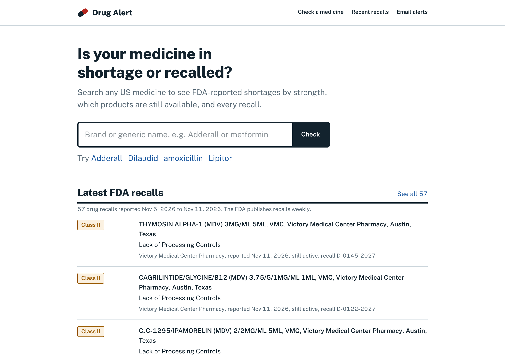
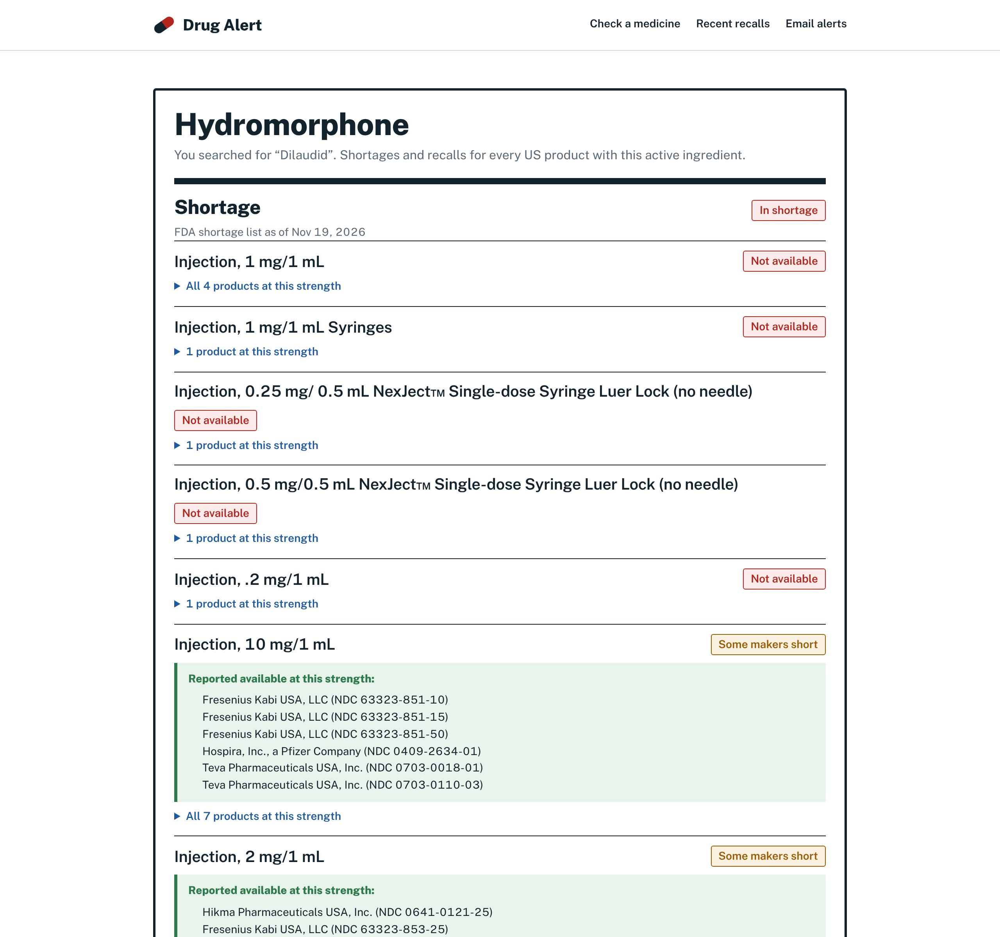
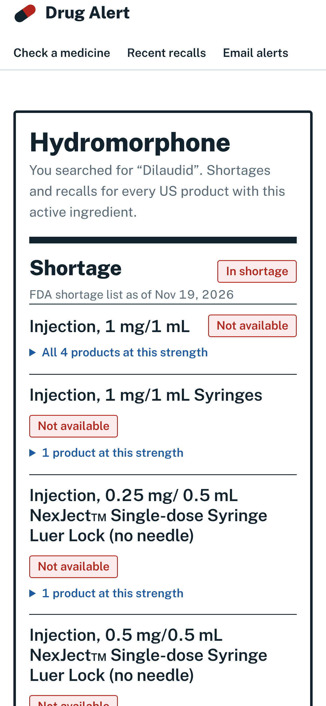
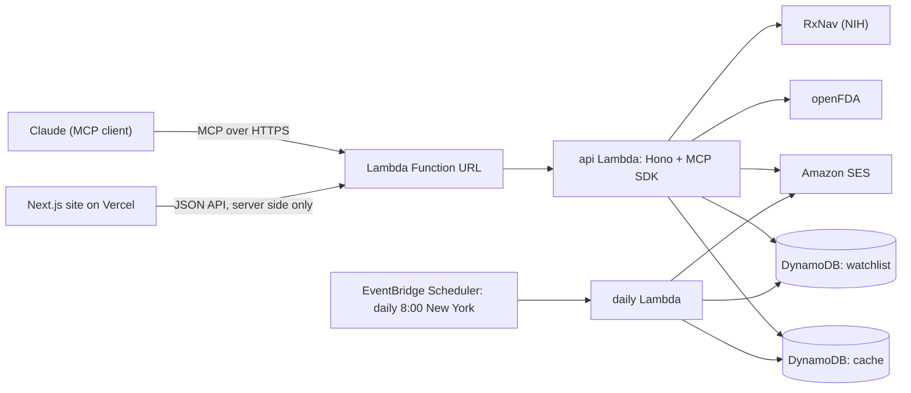

# FDA Drug Alert

**Check any US medicine for shortages and recalls, ask Claude about it, and get an email the morning a new recall is published.**

One serverless backend on AWS serves three ways in:

- **An MCP server** that Claude (or any MCP client) connects to as a custom connector
- **A Next.js website** with search, autocomplete, reports and a recall feed
- **Daily email alerts** for the medicines you watch, with double opt-in and one-click unsubscribe

**Live site: [drug-alert-seven.vercel.app](https://drug-alert-seven.vercel.app/)**



---

<p>
  
  &nbsp;
  
</p>

## Why it exists

The FDA publishes shortages and recalls through openFDA, but the raw data is hard to use:

- Patients know **brand names** ("Dilaudid", "Tylenol PM"). The FDA files things by **active ingredient**, by maker and by package.
- Shortage data is per product. What a patient needs to know is **"is my strength available from anyone?"**
- Recall text is free text. Searching openFDA's structured field for **hydromorphone** finds **9** recalls. This project's matcher finds **123** (3 active, 120 past) by also reading product descriptions and filtering out the false hits.

## Architecture



Everything is serverless and pay-per-request: no servers, nothing running between requests, and the whole stack is defined in Terraform.

| Layer | What | Why |
|---|---|---|
| Compute | 2 AWS Lambda functions, Node.js 22 on **arm64 (Graviton)** | One answers requests (MCP + JSON API + email links), one runs the daily check. Graviton is cheaper per ms than x86. |
| HTTP | **Lambda Function URL** + **Hono** | No API Gateway needed. Hono is a small web framework that runs the same code on Lambda and locally. |
| Agent interface | **Model Context Protocol** (TypeScript SDK, Streamable HTTP, stateless) | Claude calls the tools directly; one MCP server instance per request, so it scales like any other Lambda request. |
| Data | **DynamoDB** (on-demand), 2 tables | A read-through cache with TTL, and the watchlist. |
| Email | **Amazon SES v2** | Confirmation and alert emails, text + HTML. |
| Scheduling | **EventBridge Scheduler** with a time zone | Runs at 8:00 New York time all year, daylight saving included, with retries. |
| Front end | **Next.js 16** (App Router, Cache Components, Server Functions) on **Vercel** | Server components call the API; the browser never sees the Lambda URL. |
| Infrastructure | **Terraform** (AWS provider 6) | Every table, role, policy, function, URL and schedule is code. |
| Build | **esbuild** | Two Lambda entry points bundled and minified into one zip, with source maps. |

## Features

### Medicine lookup that understands brand names

- `identify` turns whatever the user typed into exact active ingredients using the openFDA NDC directory, with **RxNav spelling suggestions** for typos ("lipitr" suggests "lipitor").
- Ambiguous names return the real options instead of guessing: "Tylenol" is plain acetaminophen and several combination products, so the user (or Claude) picks one.
- **Autocomplete** over about 28,000 US drug names from RxNav, held in Lambda memory and filtered in about a millisecond.

### Shortage report grouped the way patients think

- Products grouped by **strength and form**, each group rated *not available*, *some makers short* or *available*, worst first.
- For short strengths, the makers still **reporting supply at that same strength** are listed.

### Recall matching that actually finds recalls

- Searches openFDA by both the linked ingredient field **and** the free-text product description, then filters with a custom matcher:
  - ingredient normalisation (salts, units, release types, packaging and OTC marketing words)
  - combination products split on `and`, `w/`, `/`, `+`, `&`, with dosage slashes like `5 mg/mL` left alone
  - a bracket rule for descriptions like `Brand (generic) Tablets`
  - every ingredient must be present and nothing extra, so "acetaminophen" does not match "acetaminophen and codeine"
- Active vs past recalls, Class I/II/III explained in plain words.

### Email alerts that respect the inbox

- **Double opt-in**: nothing is sent until the address owner presses Confirm.
- **Signed links**: confirm and unsubscribe links carry an **HMAC-SHA256** token (email, action, expiry), checked in constant time. Nobody can forge a link to unsubscribe someone else.
- **Scanner-safe**: opening a link only shows a button. Email security scanners open links but don't press buttons, so they can't confirm or unsubscribe anyone.
- **Only new recalls**: at confirmation, recalls already on record are marked as seen. Each watcher keeps a `notified` list, so nothing is sent twice, and a failed send is retried the next day.
- One bad address never stops the run: each watcher is handled independently.

## Caching: three layers

| Layer | Where | What | How long |
|---|---|---|---|
| 1 | Next.js `"use cache"` | API responses on the website server | 1 hour (suggestions: 1 day) |
| 2 | DynamoDB read-through cache | Name lookups, full reports, the recall window | names 30 days (misses 1 day), reports 3 hours, recall window 3 hours |
| 3 | Lambda memory | openFDA "last updated" dates, the 28,000-name autocomplete list | per warm Lambda instance |

Details that make the cache safe:

- **DynamoDB TTL** (`expiresAt`) deletes stale items for free; reads also check the expiry, because TTL deletion can lag.
- Items over **350 KB** skip the cache instead of failing on DynamoDB's 400 KB limit.
- The recall window is fetched **once per run** and shared: one FDA call whether the daily check covers 1 watcher or 500.
- The cache sits behind an interface (`CacheStore`), so tests run against memory with no AWS.

## Security and least privilege

- **One IAM role per function**, each allowed exactly what its code calls:
  - api Lambda: `GetItem`/`PutItem` on the two tables, `ses:SendEmail`, its own log group
  - daily Lambda: the same plus `Scan` on the watchlist (only it lists everyone)
  - scheduler role: `lambda:InvokeFunction` on the daily Lambda only
- SES sending is pinned with an IAM **condition**: mail can only go out from the verified sender address.
- The watchlist table has **deletion protection**; the signing secret is a `sensitive` Terraform variable with validation.
- The website calls the API from the server only (`server-only` enforced at build time).
- AWS credentials live in the local AWS profile, never in code or config files.

## MCP tools

| Tool | What it does |
|---|---|
| `check_drug` | Shortage report per strength plus active and past recalls for one medicine |
| `recent_alerts` | Recalls reported in the last 1 to 90 days, optionally filtered to a list of medicines |
| `add_to_watchlist` | Signs an email up for alerts (sends the confirmation email) |

Tool descriptions tell the model how to handle each result: ask the user to choose when a name is ambiguous, confirm spelling suggestions first, never guess an email address, and add the "not medical advice" note.

**Add it to Claude:** Settings, Connectors, Add custom connector, URL `https://<function-url>/mcp`, no sign-in.

## JSON API

| Method | Path | Returns |
|---|---|---|
| GET | `/api/suggest?q=lip` | Up to 8 name suggestions |
| GET | `/api/check?q=Dilaudid` | `found` with a report, `choose` with options, or `not_found` with suggestions |
| GET | `/api/check?q=tylenol&ingredients=acetaminophen,diphenhydramine` | The report for an exact choice |
| GET | `/api/recent?days=30&medicines=lipitor` | Recalls in the window, Class I first |
| POST | `/api/watch` | `{ email, medicines }` to start the opt-in |
| POST | `/api/watch/confirm`, `/api/watch/unsubscribe` | `{ token }` from an email link |
| GET | `/health` | `{ "ok": true }` |

## Project structure

```
src/                Lambda code (TypeScript)
  lambda.ts         api Lambda entry: Hono app with /mcp, /api, /watch, /health
  daily.ts          daily Lambda entry: runs the watchlist check
  tools.ts          MCP server and its three tools
  api.ts            JSON API for the website
  service.ts        cached versions of the core functions
  identify.ts       name to exact ingredients (openFDA NDC + RxNav)
  checkDrug.ts      shortage + recall report
  alerts.ts         recall window, matching, alert building
  normalize.ts      ingredient normalisation and product-name matching
  cache.ts          DynamoDB read-through cache with TTL
  watchlist.ts      watchlist storage (DynamoDB or memory)
  watchService.ts   opt-in, confirm, unsubscribe, daily check
  tokens.ts         HMAC-signed link tokens
  email.ts          email content and SES sending
  suggest.ts        autocomplete
  dev-server.ts     the whole API locally with no AWS
infra/              Terraform: tables, roles, policies, Lambdas, URL, SES, schedule
web/                Next.js site
```

## Run it locally

```bash
npm install

# The whole API with no AWS: in-memory watchlist, emails printed to the terminal
npx tsx src/dev-server.ts            # http://localhost:3001

# The website against it
cd web && npm install
echo "FDA_API_URL=http://localhost:3001" > .env.local
npm run dev                          # http://localhost:3000

# Or the MCP server over stdio, with the MCP Inspector
npm run inspect
```

Tests that need no AWS:

```bash
npx tsx src/try-watch.ts     # opt-in, confirm, daily check, no duplicates, unsubscribe
npx tsx src/try-routes.ts    # MCP tool + email link routes through the real HTTP app
```

## Deploy

```bash
npm run build                # esbuild: dist/lambda.mjs + dist/daily.mjs
cd infra
terraform init
terraform plan
terraform apply
```

`infra/terraform.tfvars` (not committed):

```hcl
alert_email  = "you@example.com"     # verified SES sender
watch_secret = "..."                 # openssl rand -base64 48
site_url     = "https://your-site.vercel.app"  # email links point here
```

The website deploys to Vercel with root directory `web` and one environment variable, `FDA_API_URL`.

## Roadmap

- GitHub Actions deploys with AWS OIDC (no stored keys) and remote Terraform state in S3
- Own domain: SES production access, mail from `alerts@` the domain
- CloudWatch alarms on Lambda errors and the daily run
- Rate limiting on the public endpoints
- Alerts when a watched medicine goes into shortage, not only recalls
- The same MCP server on Cloudflare Workers

## Data and disclaimer

Data comes from [openFDA](https://open.fda.gov/) and [RxNav](https://lhncbc.nlm.nih.gov/RxNav/) (National Library of Medicine). openFDA data may be unvalidated. US medicines only. Availability is what manufacturers report to the FDA, not what a particular pharmacy has in stock.

**This is not medical advice.** Talk to a pharmacist or doctor before stopping or changing any medicine. An independent project, not affiliated with or endorsed by the U.S. Food and Drug Administration.

---

Built by Hassan. [Work with me on Contra](https://on.contra.com/TG7Lzh)
